<h1 align="center">TodoPet cho GNOME</h1>

<p align="center">
Một chú pet nhỏ cho Ubuntu (GNOME Shell), đi dạo dọc đáy màn hình, đọc công việc từ <a href="https://todoist.com">Todoist</a>,
<b>vui khi bạn làm việc</b> và <b>nổi cáu khi bạn lười</b>.<br>
<a href="README.md">English</a> · Tiếng Việt
</p>

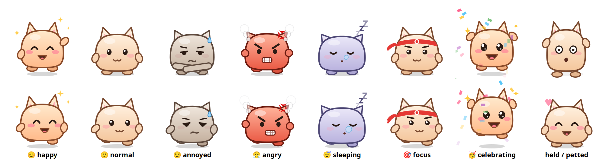

Đây là bản chuyển ứng dụng macOS [trananhtung/todopet](https://github.com/trananhtung/todopet) sang **tiện ích mở rộng GNOME Shell**. Tính năng, ngưỡng, điểm số và lời thoại (tiếng Việt và tiếng Anh) đều giữ nguyên. Những chỗ buộc phải khác được ghi ở mục [Khác gì bản Mac](#khác-gì-bản-mac).

## Pet làm được gì

- **Đi dạo trên màn hình.** Mochi đi qua đi lại dọc đáy màn hình (đứng trên dock nếu dock nằm dưới), nhìn theo con trỏ, và đứng lại khi bạn rê chuột vào. Kéo thả đi đâu cũng được, thả ra nó sẽ rơi xuống lại.
- **Hỏi "Hôm nay làm gì?".** Nếu hôm nay chưa có đủ **3 việc** (chỉnh được), pet sẽ nhắc bạn lên kế hoạch: buổi sáng hỏi nhẹ nhàng, qua giờ hạn chót thì nhắc gắt dần.
- **Nhắc đúng việc cần làm.** Pet chọn việc tiếp theo theo kiểu "ăn con ếch trước" (ưu tiên cao nhất, rồi giờ sớm nhất), nhắc mỗi 45 phút, và báo trước 10 phút với việc có giờ cụ thể.
- **Có tâm trạng thật.** Pet ăn mừng mỗi việc bạn xong (kể cả việc tích trong app Todoist), và nhăn nhó, rồi nổi cáu, khi có việc quá hạn, nhiều giờ không tiến triển, hoặc bạn ngồi lâu trong app gây xao nhãng. Lúc cáu nó còn hầm hầm đi về phía con trỏ chuột 😤
- **Làm việc với Todoist ngay trên pet.** Bấm vào pet để xem việc hôm nay, tích hoàn thành, thêm việc mới (Hôm nay / Ngày mai / Không hạn, độ ưu tiên, hoặc cú pháp quick-add của Todoist như `Gọi Lan 3pm p1 #Work`), dời việc sang hôm nay hoặc ngày mai, xoá việc (có bước xác nhận, vì Todoist không khôi phục được), và xem chuỗi ngày (streak) trên Todoist.
- **Có hẹn giờ tập trung.** Bắt đầu phiên 25 phút cho một việc, pet đeo băng đô rồi ngồi im trong góc. Hết giờ, pet hỏi bạn xong chưa; nếu xong, pet tự đánh dấu hoàn thành trên Todoist và bắt đầu giờ nghỉ.
- **Tổng kết cuối ngày.** 30 phút trước giờ tan làm, pet cho bạn xem đã xong bao nhiêu việc và đề nghị dời phần còn lại sang mai.
- **Bắt quả tang trang web gây xao nhãng.** Pet đọc tiêu đề cửa sổ trình duyệt đang mở (Firefox, Chrome, Chromium, Brave, Edge, Vivaldi, Opera, Cốc Cốc, kể cả bản Flatpak). Ngồi YouTube hay Facebook quá 2 phút trong giờ làm là pet bắt đầu nhăn nhó. Bạn tự chọn danh sách trang; quy tắc như `youtube.com/shorts` chỉ bắt đúng một phần của trang. Pet so khớp theo tiêu đề nên chỉ gần đúng (xem [bên dưới](#khác-gì-bản-mac)).
- **Biết lịch họp của bạn.** Pet đọc các sự kiện hôm nay từ Lịch của GNOME (gồm cả tài khoản Google, Microsoft 365 đã thêm trong Cài đặt › Tài khoản trực tuyến). Pet nhắc trước giờ họp 5 phút, im lặng khi bạn đang họp, và không tính giờ họp là lười. Ngày nào họp nhiều thì pet hạ mục tiêu, khoảng 2 giờ trống cho 1 việc quan trọng. Nút **Join** cho link Meet, Zoom, Teams cần thêm một gói tuỳ chọn (xem [Lịch](#lịch)).
- **Gợi ý khung giờ.** Pet xếp các việc tiếp theo vào khoảng trống trong ngày ("10:00–11:00 Viết báo cáo"). Một cú bấm là đặt giờ đó cho việc trong Todoist, và pet sẽ nhắc bạn đúng giờ.
- **Phát hiện việc bị dời mãi.** Việc nào nằm trong danh sách từ 3 ngày trở lên, pet hỏi bạn muốn chia nhỏ hay bỏ khỏi kế hoạch. Chia nhỏ là tách thành các bước 15–30 phút, thêm vào Todoist dưới dạng việc con, bước 1 vào kế hoạch hôm nay. Nếu có API key Claude, nút **Nhờ Claude gợi ý** sẽ đề xuất các bước giúp bạn.
- **Nói tiếng Việt và tiếng Anh**, đổi trong Cài đặt (mặc định theo ngôn ngữ hệ thống).

### Một chú pet sống cùng công việc của bạn

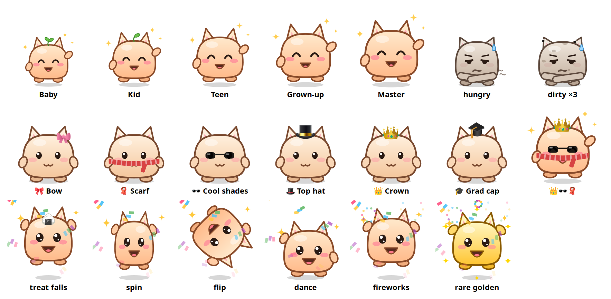

- **Làm xong việc là cho pet ăn.** Mỗi việc xong là một món ngon rơi vào miệng pet (+25% độ no). Độ no giảm khoảng 7% mỗi giờ làm việc, nên lười cả ngày thì pet gầy, đói, bụng réo. Mỗi ngày làm việc mà không xong việc nào, pet bẩn thêm một lớp, tối đa 3 lớp, kèm ruồi bay quanh. Mỗi việc xong tắm sạch một lớp. Tất cả giữ nguyên sang ngày hôm sau.
- **Nhìn pet lớn lên.** Việc xong cho XP, và pet lớn dần từ Em bé (có mầm lá trên đầu) lên Nhóc, Thiếu niên, Trưởng thành, Cao thủ.
- **Ăn mừng bất ngờ.** Mỗi việc xong là một kiểu ngẫu nhiên: nhảy, xoay, lộn nhào, nhảy disco. 1/10 lần là bánh vàng hiếm, pet hoá vàng. Xong việc liên tiếp trong vòng 30 phút sẽ thành combo ×2, ×3…, nhiều XP hơn, và kết bằng pháo hoa.
- **Mở khoá đồ để mặc.** Nơ, khăn, kính râm, mũ quý ông, vương miện, mũ tốt nghiệp, mở theo các cột mốc: việc đầu tiên, chuỗi 3 ngày, combo ×3, 25 việc, chuỗi 7 ngày… Có thêm sổ sticker ghi lại những ngày bạn làm trọn kế hoạch.
- **Quậy leo thang khi bạn lười.** Nhăn nhó 10 phút thì pet thở dài, giậm chân. Cáu 10 phút thì pet diễu hành ngang màn hình, kéo theo tấm biển ghi tên việc bạn đang né. Đang cáu mà ngồi YouTube 5 phút thì pet nhảy lên giữa màn hình kèm (╯°□°)╯︵ ┻━┻. Cuối ngày, pet hờn dỗi báo bạn đã lướt mạng bao lâu. Pet có thể nói thành tiếng (mặc định tắt).
- **Quậy có luật.** Không quậy khi bạn đang họp, đang tập trung hay đã rời máy. Trò lớn tối đa 20 phút một lần. Mỗi trò có nút **Tha cho tôi 15'**, và bấm vào pet là pet thôi quậy. Bạn có thể tắt hẳn trò quậy trong Cài đặt.

| Tủ đồ | Trò quậy |
|---|---|
| 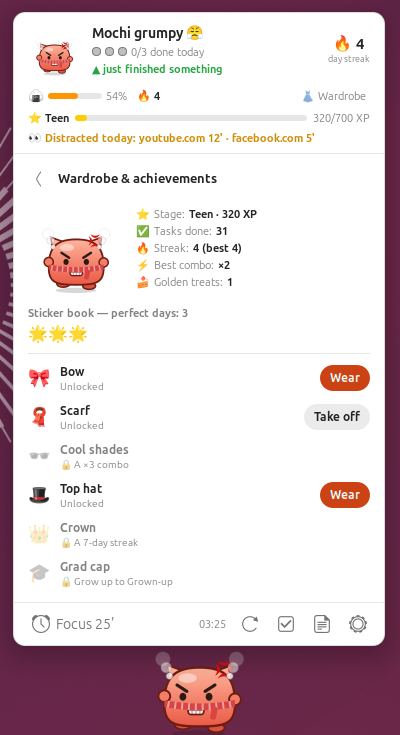 | <br><br>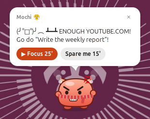 |

| Bảng việc | Bong bóng thoại | Chia nhỏ việc |
|---|---|---|
| 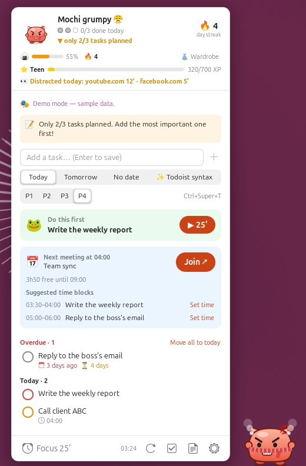 | 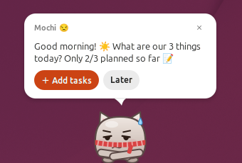<br>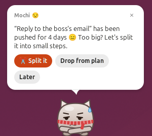 | 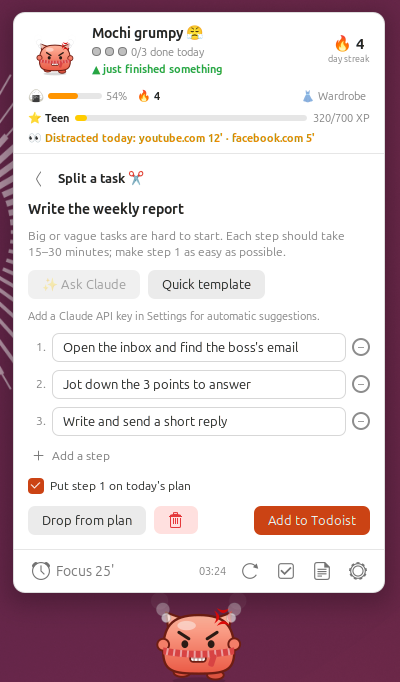 |

Ảnh chụp lấy từ một GNOME Shell chạy ngầm với dữ liệu mẫu có sẵn (`make snapshot` và `tools/nested.sh`, xem [Phát triển](#phát-triển)), nên giao diện hiện bằng tiếng Anh.

## Cài đặt

Cần **GNOME Shell 50** (Ubuntu 26.04) với phiên **Wayland**, cùng `git` và `make`.

```bash
git clone https://github.com/trananhtung/todopet-gnome.git
cd todopet-gnome
make install
```

`make install` biên dịch schema cài đặt rồi chép tiện ích vào `~/.local/share/gnome-shell/extensions/todopet@trananhtung.github.io` (dùng `EXT_DIR=/thư/mục/khác` để chép chỗ khác). Lệnh này không đụng tới gì khác.

Sau đó **đăng xuất rồi đăng nhập lại**. Trên Wayland, GNOME Shell không tự nạp lại được, nên chỉ thấy tiện ích mới khi đăng nhập. Rồi bật nó lên:

```bash
gnome-extensions enable todopet@trananhtung.github.io
```

Mochi sẽ hiện ở đáy màn hình, và `🐾` (hoặc `😊 0/3` khi đã kết nối) hiện trên thanh trên cùng.

Để cập nhật: `git pull`, chạy lại `make install`, rồi đăng xuất và đăng nhập. Để gỡ: `gnome-extensions uninstall todopet@trananhtung.github.io`. Dữ liệu của bạn vẫn nằm trong `~/.local/share/todopet` và token trong GNOME Keyring cho tới khi bạn xoá.

Mỗi bản phát hành (tag) trên GitHub còn có sẵn file `todopet@trananhtung.github.io.shell-extension.zip`, cài bằng `gnome-extensions install --force <file zip>` (rồi đăng xuất, đăng nhập).

Muốn xem thử trước? Bấm vào pet rồi bấm **Xem thử (demo)** (hoặc bật **Chế độ demo** trong menu thanh trên cùng, hay Cài đặt › Phát triển). Bạn sẽ có việc và cuộc họp mẫu, không gửi gì đi đâu cả.

Các gói tuỳ chọn:

| Gói | Thêm được gì |
|---|---|
| `gir1.2-ecal-2.0` | Nút **Join** cho link họp (xem [Lịch](#lịch)) |
| `speech-dispatcher` (lệnh `spd-say`, thường đã có sẵn) | Pet nói thành tiếng |

## Kết nối Todoist

1. Trong Todoist, vào **Cài đặt → Tích hợp → Developer** ([link thẳng](https://app.todoist.com/app/settings/integrations/developer)) và sao chép **API token**.
2. Bấm vào pet, dán token vào màn hình thiết lập rồi bấm **Lưu & kết nối**. (Bạn cũng dán được trong Cài đặt › Todoist; bảng việc sẽ nhận token đó.)

Token được lưu trong **GNOME Keyring** (qua libsecret) và chỉ được gửi tới `api.todoist.com` (Todoist API v1). Token không bao giờ nằm trong cài đặt của tiện ích hay trong một file nào. Muốn ngắt kết nối, bấm **Ngắt kết nối** trong Cài đặt › Todoist.

### Lịch

TodoPet đọc các sự kiện hôm nay từ chính dịch vụ lịch mà đồng hồ trên thanh trên cùng dùng. Để có lịch của bạn:

- Thêm tài khoản trong **Cài đặt › Tài khoản trực tuyến** (Google, Microsoft 365), hoặc thêm lịch trong GNOME Calendar hay Evolution.
- Bật hoặc tắt **Đọc Lịch của GNOME** trong Cài đặt › Lịch (mặc định bật).

Nhờ đó pet nhắc trước giờ họp, im lặng khi họp, biết giờ trống, gợi ý khung giờ và hạ mục tiêu vào ngày bận.

Dịch vụ lịch của shell chỉ trả về tên và giờ, nên mặc định **không có nút Join**. Muốn có, cài thêm gói tuỳ chọn của Evolution Data Server:

```bash
sudo apt install gir1.2-ecal-2.0
```

Rồi đăng xuất và đăng nhập lại. Khi có gói này, TodoPet đọc sự kiện qua Evolution Data Server và tìm link Meet, Zoom, Teams trong địa điểm, ghi chú và URL của từng sự kiện. Cài đặt › Lịch cho biết nút Join đang bật hay tắt, và gói nào cần cài nếu đang tắt.

> **Lưu ý:** đường đọc Join link (mã `gi://ECal`) được viết theo API libecal 2.0 và phần chuyển đổi sự kiện đã có test, nhưng **chưa chạy thử được trên máy phát triển** vì máy đó chưa cài `gir1.2-ecal-2.0`. Đường mặc định (dịch vụ lịch của shell) đã được kiểm thử đầy đủ. Nếu cài gói rồi mà vẫn không thấy nút Join, bạn [mở issue](https://github.com/trananhtung/todopet-gnome/issues) kèm kết quả của `journalctl --user -b | grep -i todopet` nhé.

### Chia nhỏ việc bằng Claude (tuỳ chọn)

Thêm API key Anthropic trong **Cài đặt › Bị dời mãi** ([lấy key](https://console.anthropic.com/settings/keys)); key được lưu trong GNOME Keyring. Khi bạn bấm **Nhờ Claude gợi ý**, tên và ghi chú của việc được gửi tới Claude API, và Claude trả về 3–5 bước nhỏ. Model mặc định là `claude-opus-5-5` ở mức effort thấp, có bật fallback phía máy chủ phòng khi yêu cầu bị từ chối. Mỗi lần khoảng 1–2 xu Mỹ; bạn đổi được model trong Cài đặt. Không có key thì bạn vẫn tự gõ các bước hoặc dùng mẫu nhanh.

### Pet nói thành tiếng (tuỳ chọn)

Bật **Pet nói thành tiếng** trong Cài đặt › Chung. Lời thoại được đọc bằng `spd-say` (speech-dispatcher), tiếng Việt hoặc tiếng Anh, chạy trên máy bạn. Mặc định tắt, và công tắc bị khoá kèm gợi ý khi máy chưa có `spd-say`.

### Dùng Todoist qua Claude hoặc AI khác (MCP)

TodoPet nói chuyện trực tiếp với Todoist bằng API token. Nếu bạn muốn quản lý việc bằng cách chat với trợ lý AI, hãy kết nối MCP server chính thức của Todoist tại `https://ai.todoist.net/mcp`. Với Claude Code: `claude mcp add --transport http todoist https://ai.todoist.net/mcp`; với Claude Desktop thì thêm làm custom connector. Việc tạo ở đó sẽ hiện trên pet trong vòng 3 phút, hoặc ngay khi bạn bấm vào pet.

## Cách dùng

| Thao tác | Kết quả |
|---|---|
| Bấm vào pet | Mở bảng việc (Esc hoặc bấm ra ngoài để đóng) |
| Rê chuột vào một việc trên bảng | ▶︎ tập trung · ✂️ chia nhỏ · → dời · 🗑 xoá (hỏi lại trước khi xoá; việc con và cả chuỗi lặp lại cũng bị xoá, không hoàn tác được) |
| Kéo pet | Di chuyển; thả ra pet rơi xuống đáy màn hình |
| Rê chuột vào | Pet đứng lại và đỏ mặt |
| Chuột phải vào pet / bấm biểu tượng trên thanh trên cùng | Menu nhanh: mở bảng việc, thêm việc, tập trung, gọi pet về đây, ẩn 1 giờ, im lặng 1 giờ, làm mới, nhật ký, cài đặt |
| <kbd>Ctrl</kbd><kbd>Super</kbd><kbd>T</kbd> | Mở bảng việc với ô thêm việc sẵn sàng, từ bất kỳ app nào |

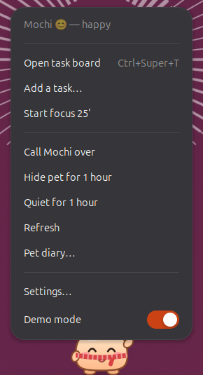

Thanh trên cùng hiện tâm trạng và tiến độ hôm nay (`😊 2/3`), hoặc đồng hồ khi đang tập trung (`🍅 18:42`, còn `☕` khi nghỉ). Chưa có token thì hiện `🐾`.

### Phím tắt

Mặc định là **Ctrl+Super+T** (Ubuntu dành Ctrl+Alt+T cho Terminal). Đổi trong **Cài đặt › Phím tắt**: bấm **Đặt…** rồi nhấn tổ hợp phím bạn muốn. Cần Ctrl, Alt hoặc Super đi kèm một phím. Trong hộp bắt phím, Esc để huỷ, Backspace để tắt phím tắt; **Mặc định** đưa về Ctrl+Super+T. Nếu chương trình khác đã giữ tổ hợp đó thì bảng việc sẽ không mở được bằng nó, hãy chọn tổ hợp khác.

### Cài đặt

Mở Cài đặt bằng nút bánh răng trên bảng việc, menu nhanh, hoặc `gnome-extensions prefs todopet@trananhtung.github.io`. Đó là một cửa sổ GNOME (libadwaita) bình thường.

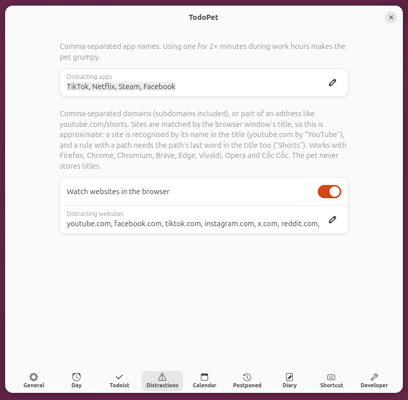

## Tâm trạng được tính thế nào

Mochi có điểm hạnh phúc từ 0 đến 100, tính lại mỗi 15 giây. Rê chuột vào dòng lý do trên bảng việc để xem chi tiết.

| Làm pet vui hơn | Làm pet cáu hơn |
|---|---|
| +8 cho mỗi việc xong hôm nay | −7 cho mỗi việc quá hạn |
| +30 khi xong hết kế hoạch hôm nay | −4 cho mỗi việc đã trễ giờ |
| Tới +15 ngay sau khi bạn xong một việc | −12 đến −50 khi qua hạn lên kế hoạch mà chưa đủ 3 việc |
| +10 khi đang tập trung | Tới −30 khi hơn 90 phút không có tiến triển |
| Giờ họp được tính là làm việc | Tới −35 khi ở trong app hoặc trang web gây xao nhãng hơn 2 phút |
| | −3 cho mỗi việc bị dời mãi (tối đa −9) |
| | Tới −15 khi pet đói (dưới 30% no) |
| | −5 cho mỗi lớp bẩn |

Từ 75 điểm là vui, từ 50 là bình thường, từ 30 là nhăn nhó, thấp hơn nữa là nổi cáu. Ngoài giờ làm, ban đêm, khi đang họp, hoặc khi bạn rời máy 10 phút, pet dịu lại hoặc ngủ, và không bao giờ cằn nhằn lúc bạn vắng mặt.

## Khi nào pet lên tiếng

Theo thứ tự ưu tiên, mỗi lúc chỉ một bong bóng:

1. Vài phút trước giờ họp (kể cả khi đang tập trung), sau đó im lặng tới khi họp xong
2. 10 phút trước và đúng giờ của việc có giờ cụ thể
3. Chào buổi sáng kèm kế hoạch hôm nay (hoặc nhắc lên kế hoạch) và tóm tắt lịch họp, giờ trống
4. "Hôm nay mình làm 3 việc gì nào?" mỗi 30 phút sau hạn lên kế hoạch, cho tới khi đủ việc
5. Mở app hoặc trang web gây xao nhãng quá 2 phút
6. Việc bị dời mãi: chia nhỏ hay bỏ khỏi kế hoạch
7. Đói: xin bạn xong một việc, tối đa mỗi giờ một lần
8. Quậy khi bạn lười: càu nhàu, rồi diễu hành với tấm biển (trò lật bàn đi kèm mục 5)
9. Việc quá hạn, mỗi 90 phút
10. Mỗi ngày một lần, gợi ý khung giờ cho việc tiếp theo
11. Tổng kết cuối ngày, rồi báo cáo hờn dỗi nếu bạn xao nhãng từ 10 phút trở lên
12. Nhắc việc tiếp theo, mỗi 45 phút
13. Thỉnh thoảng một mẹo năng suất, chỉ khi pet đang vui

Mọi mốc thời gian đều chỉnh được trong **Cài đặt**: số việc mỗi ngày, giờ làm, ngày làm việc, hạn lên kế hoạch, khoảng nhắc, độ dài phiên tập trung và giờ nghỉ, app và trang web gây xao nhãng, tuỳ chọn Lịch, sau bao nhiêu ngày thì tính là bị dời mãi, bộ lọc Todoist riêng cho "việc của tôi" (ví dụ `(today | overdue) & #Work`), kích thước pet, âm thanh, trò quậy, giọng nói, và bảo vệ tập trung.

Khi màn hình bị khoá, pet và các bong bóng sẽ ẩn đi, nhưng tiện ích vẫn chạy: hẹn giờ tập trung vẫn đếm tiếp và kết quả chốt ngày không bị mất. Phiên tập trung đang chạy cũng được lưu xuống đĩa, nên khởi động lại GNOME Shell không làm mất nó.

## Thiết kế để không làm bạn mất tập trung

Một app nhắc việc mà cắt ngang lúc bạn đang tập trung thì hại nhiều hơn lợi. Vì vậy pet làm theo các khuyến nghị từ nghiên cứu về sự gián đoạn:

| Nguyên tắc | Vì sao |
|---|---|
| **Chỉ ngắt ở điểm nghỉ.** Lời nhắc không gấp đợi tới khi bạn ngừng gõ vài giây hoặc chuyển app. Nhắc họp và việc tới giờ vẫn đến đúng lúc. | Bị ngắt ở ranh giới giữa các việc đỡ bực và quay lại việc nhanh hơn bị ngắt giữa chừng (Adamczyk & Bailey 2004; Iqbal & Bailey 2008). |
| **Bảo vệ lúc vào guồng.** Gõ phím đều đặn 10 phút trong app làm việc thì pet hiện 🎧, giữ lại mọi lời nhắc không gấp và tính thời gian đó là tiến độ. Không nhăn nhó, không quậy. | Quay lại mạch làm việc sau khi bị ngắt rất chậm và gây căng thẳng (Mark và cộng sự 2008). |
| **Ít bong bóng hơn.** Hai lời nhắc tự phát cách nhau ít nhất 15 phút (chỉnh được), mỗi lúc một cái. | Thông báo được gom lại, ít hơn giúp tập trung và dễ chịu hơn (Fitz và cộng sự 2019). |
| **Đứng yên khi bạn gõ phím.** Pet thôi đi lại, cử động nhẹ đi; khi bạn nghỉ tay pet mới đi tiếp. | Chuyển động ở rìa tầm mắt kéo sự chú ý một cách vô thức (Bartram và cộng sự 2003). |
| **Mặc định yên lặng.** Âm thanh để ở mức "chỉ khi quan trọng" (sắp họp, việc tới giờ, hết phiên tập trung, xong việc) và nhỏ. Bong bóng thường hiện lặng lẽ, mờ dần vào. | "Calm technology": báo tin ở vùng ngoại vi, chỉ chiếm trung tâm khi thật cần (Weiser & Brown 1996). |
| **Chỉ quậy khi bạn lười, không quậy khi bạn làm.** Không quậy khi bạn đang gõ phím, đang họp, đang tập trung hoặc đã rời máy. | Cằn nhằn người đang làm việc chỉ làm đứt mạch của họ. |

Âm thanh có 3 mức trong Cài đặt: **Tắt**, **Chỉ khi quan trọng** (mặc định) và **Tất cả**. Đó là những tiếng chuông nhẹ lấy từ bộ âm thanh của hệ thống.

### Nhật ký pet

Để chỉnh mọi thứ cho hợp với cách bạn thực sự làm việc, pet ghi nhật ký (nút 📜 trên bảng việc, hoặc **Nhật ký pet…** trong menu nhanh). Nhật ký ghi lại:
- mỗi lời nhắc và lý do pet nhắc
- bạn đã làm gì với lời nhắc đó (bấm nút nào, tự đóng, hay để nó tự ẩn)
- mỗi lần pet hoãn nhắc (bạn đang vào guồng, đang gõ phím, hoặc pet vừa nhắc gần đây)
- cuộc họp, phiên tập trung, lúc tâm trạng đổi kèm lý do chính, thời gian ở trang gây xao nhãng, lúc pet được ăn và kết quả chốt ngày

Dòng tóm tắt cho biết bạn nhận bao nhiêu lời nhắc và bỏ qua bao nhiêu. Nút **Sao chép** chép cả ngày, để bạn dán cho Claude và nhờ chỉnh lại. Nhật ký chỉ nằm trên máy bạn (`~/.local/share/todopet/log`, mỗi ngày một file), giữ 14 ngày, và tắt được trong Cài đặt › Nhật ký. Nút **Mở thư mục** mở các file đó ra.

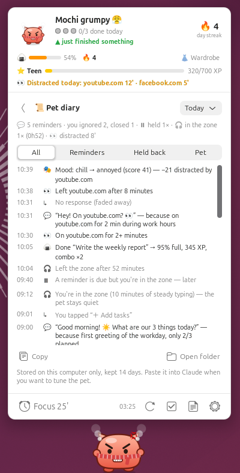

## Vì sao có những tính năng này

Hành vi của pet dựa trên các phương pháp năng suất phổ biến, cố tình giữ đơn giản:

- **Quy tắc 3 việc**: mỗi ngày chọn ba kết quả quan trọng thay vì một danh sách dài vô tận (J.D. Meier, *Getting Results the Agile Way*).
- **Ăn con ếch trước**: bắt đầu bằng việc quan trọng nhất (Brian Tracy).
- **Ý định thực hiện**: việc có giờ cụ thể ("14h mình sẽ…") dễ được làm hơn (Peter Gollwitzer). Pet nhắc bạn đúng giờ.
- **Pomodoro**: các phiên tập trung ngắn có hẹn giờ, xen kẽ nghỉ (Francesco Cirillo).
- **Bị gián đoạn rất tốn kém**: quay lại việc sau khi chuyển sang thứ khác mất khá lâu (nghiên cứu của Gloria Mark), nên pet nhắc khi bạn mở app hoặc trang web gây xao nhãng, và im lặng khi bạn tập trung hoặc đang họp.
- **Chặn lịch (time blocking)**: gắn cho việc một khung giờ trong lịch giúp giữ thời gian cho nó; pet tìm các khoảng trống giữa các cuộc họp.
- **Trì hoãn thường do việc quá to hoặc mơ hồ**: tách ra một bước đầu nhỏ, cụ thể sẽ dễ bắt tay vào hơn, nên pet gợi ý chia nhỏ những việc bạn cứ dời mãi.
- **Nghi thức kết thúc ngày**: khép lại ngày bằng cách xem lại và dời việc (Cal Newport).
- **Phản hồi cảm xúc**: một nhân vật phản ứng rõ ràng với tiến độ của bạn khiến việc hoàn thành có cảm giác được thưởng, còn lười thì hơi áy náy.
- **Chăm một con pet** ("hiệu ứng Tamagotchi", app Finch đang dùng): bạn làm việc một phần để pet được no và sạch, và hậu quả kéo dài qua nhiều ngày. Sợ mất thứ đang có thúc đẩy mạnh hơn mong được thêm.
- **Phần thưởng bất ngờ**: màn ăn mừng ngẫu nhiên và bánh vàng hiếm giữ được hứng thú lâu hơn phần thưởng cố định, nên game nào cũng dùng.

## Khác gì bản Mac

Mọi thứ còn lại (ngưỡng, điểm số, luật nhắc, luật đời sống của pet và từng câu pet nói) chạy giống hệt app Mac. Những điểm khác:

| App Mac | Tiện ích GNOME |
|---|---|
| Cửa sổ nổi trên Dock | Do chính GNOME Shell vẽ, dọc đáy vùng làm việc của màn hình chính. Chỉ pet và bong bóng nhận cú bấm; mọi thứ khác bấm xuyên qua. |
| Đọc **địa chỉ** tab đang mở của trình duyệt | So khớp danh sách trang của bạn với **tiêu đề cửa sổ trình duyệt** đang mở, vì Wayland không cho đọc địa chỉ của trình duyệt. Xem bên dưới. |
| Biết khi bạn nhấn phím | **Suy đoán việc gõ phím**: một giây được tính là đang gõ khi có thao tác nhập nhưng con trỏ không nhúc nhích. Không có keylogger, và không có gì đọc xem bạn nhấn phím nào. |
| ⌃⌥T mở bảng việc | **Ctrl+Super+T** (Ubuntu dành Ctrl+Alt+T cho Terminal). Đổi được trong Cài đặt › Phím tắt. |
| Lịch EventKit | Lịch của GNOME (Tài khoản trực tuyến, GNOME Calendar, Evolution). Nút **Join** cần `gir1.2-ecal-2.0`. |
| Keychain | GNOME Keyring (libsecret) |
| Giọng macOS | `spd-say` (speech-dispatcher) |
| Âm thanh macOS | Tiếng chuông nhẹ từ bộ âm thanh freedesktop |
| Mục "mở cùng macOS" | Không có. GNOME Shell tự khởi động tiện ích. |
| Biểu tượng trên thanh menu | Biểu tượng trên thanh trên cùng, cùng nhãn và menu |
| Cửa sổ Cài đặt | Cửa sổ cài đặt libadwaita (có thêm trang **Phát triển** với chế độ demo và nút chạy thử trò quậy, ăn mừng) |

Nút bấm và điểm nhấn dùng màu nhấn của hệ thống (Cài đặt › Giao diện), giống app Mac dùng màu nhấn của macOS.

### Trang web gây xao nhãng được so khớp theo tiêu đề cửa sổ

Trình duyệt đặt tên trang vào tiêu đề cửa sổ (`Watch later - YouTube — Mozilla Firefox`), nên TodoPet so khớp với đó. Cách này **chỉ gần đúng**:

- Tên miền quen thuộc được nhận ra qua tên xuất hiện trong tiêu đề: `youtube.com` qua "YouTube", `facebook.com` qua "Facebook", `x.com` qua "/ X" hoặc "Twitter", v.v.
- Tên miền khác được so khớp qua phần tên chính (`vnexpress.net` qua "vnexpress"), không phân biệt hoa thường, và phải là nguyên một từ.
- Quy tắc có đường dẫn, như `youtube.com/shorts`, cần có **cả** tên trang **và** từ cuối của đường dẫn ("Shorts") trong tiêu đề.
- Trang mà tiêu đề không nhắc tên trang sẽ không bị bắt, và trang có tiêu đề bài viết nhắc tới tên trang thì có thể bị bắt nhầm.
- **Ứng dụng** gây xao nhãng (danh sách trong trang Xao nhãng) được so khớp theo tên app hoặc window class. Trình duyệt Flatpak cũng được nhận ra.

## Quyền riêng tư

- Không thu thập dữ liệu, không có máy chủ riêng. Kết nối mạng chỉ tới `api.todoist.com`, và tới `api.anthropic.com` khi bạn bấm **Nhờ Claude gợi ý** (chỉ tên và ghi chú của việc được gửi đi).
- Phát hiện xao nhãng đọc **tên app đang được focus** và, nếu đó là trình duyệt, **tiêu đề cửa sổ của nó**. Tiêu đề chỉ nằm trong bộ nhớ, không được lưu hay gửi đi đâu. Không cần quay màn hình hay thêm quyền nào.
- "Gõ phím" chỉ là suy đoán từ thời điểm có thao tác nhập (nhập trong lúc con trỏ đứng yên). TodoPet chỉ đọc lần thao tác cuối cách đây bao lâu và vị trí con trỏ. Nó không bao giờ đọc bạn nhấn phím nào và không có keylogger.
- Lịch được đọc ngay trên máy từ dịch vụ lịch của GNOME (hoặc Evolution Data Server); TodoPet không đưa sự kiện ra khỏi máy bạn.
- Token Todoist và key Anthropic nằm trong GNOME Keyring, không nằm trong file hay dconf.
- Nhật ký "việc bị dời mãi" chỉ gồm mã việc và ngày, còn đời sống của pet (độ no, XP, phụ kiện, số phút xao nhãng hôm nay theo từng trang), cả hai đều lưu cục bộ dạng file JSON trong `~/.local/share/todopet`. Nhật ký pet nằm trong `~/.local/share/todopet/log`, có ghi lời nhắc, tên cuộc họp, trang web và tên việc; nó không rời khỏi máy bạn và bạn tắt được. Xoá thư mục đó là bắt đầu lại từ đầu.
- Giọng nói dùng speech-dispatcher, chạy trên máy bạn.
- Phát hiện vắng mặt chỉ đọc "số giây từ lần thao tác cuối" từ GNOME Shell.

## Phát triển

```bash
make test          # test logic (ngày tháng, API, tâm trạng, so khớp trang web, lịch, ...); kết thúc bằng "All good 🎉"
make lint          # ESLint (chạy `npm ci` một lần; cần Node 20.19+)
make snapshot      # vẽ các tâm trạng, bảng đời sống và tấm biển ra out/*.png (không cần GNOME Shell)
make prefs-check   # dựng cửa sổ cài đặt trên màn hình GTK tạm và kiểm tra từng trang
tools/nested.sh    # chạy mọi cảnh dev trong một GNOME Shell lồng, chạy ngầm, tách biệt; ảnh chụp vào build/nested/shots
tools/nested.sh board split diary   # hoặc chỉ một số cảnh ('prefs:Day' mở một trang cài đặt)
make build         # chép tiện ích vào build/todopet@trananhtung.github.io/ và biên dịch schema
make pack          # tạo file zip của tiện ích trong build/ (cần lệnh gnome-extensions của gói gnome-shell)
```

`tools/nested.sh` không bao giờ đụng tới phiên làm việc thật của bạn: nó chạy `gnome-shell --headless` riêng với các thư mục `XDG_*` riêng trong `build/nested/`, cài tiện ích vào đó với chế độ demo bật, và không đọc keyring của bạn. Chạy hết các cảnh mất khoảng 4 phút và báo lỗi nếu nhật ký có lỗi JavaScript.

Lối tắt `TODOPET_ANTIC=parade` của app Mac được thay bằng **Cài đặt › Phát triển**, nơi bạn chạy thử diễu hành, lật bàn và từng kiểu ăn mừng ngay lập tức.

Mã nguồn nằm trong `extension/` (phần nào chuyển từ file Mac nào đều được ghi trong chú thích):

| Đường dẫn | Vai trò |
|---|---|
| `extension/core/` | Logic thuần, chỉ import GLib và Gio nhiều nhất, test được bằng `gjs`: ngày tháng, tâm trạng, luật yên tĩnh, đời sống pet, tính toán lịch, việc bị dời mãi, so khớp trang web, lời thoại (EN + VI), nhật ký |
| `extension/brain.js`, `extension/brain/` | Đồng bộ, tâm trạng, luật nhắc, hẹn giờ tập trung, hành động (chuyển từ `Brain.swift`) |
| `extension/services/` | Todoist, Claude, lịch (ECal và CalendarServer), GNOME Keyring, vắng mặt và gõ phím, theo dõi cửa sổ, giọng nói, âm thanh, kho JSON |
| `extension/art/` | Pet được vẽ bằng code với Cairo cho từng tâm trạng |
| `extension/ui/` | Pet, bong bóng, bảng việc, chia nhỏ việc, tủ đồ, nhật ký, trò quậy, biểu tượng thanh trên cùng |
| `extension/prefs.js` | Cửa sổ cài đặt |
| `tests/` | Bộ test (`gjs -m tests/run.js`) |

Đây là JavaScript thuần (GJS, ES modules), không có thư viện chạy kèm. GitHub Actions chạy lint, test và snapshot ở mỗi lần push, và dựng file zip của tiện ích cho mỗi tag `v*`.

## Giấy phép

[MIT](LICENSE)
